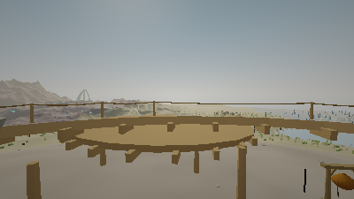

# Y'SMARA — THE HOLLOW HYMN

> *"Eight sang to keep the world. The eighth stopped. Something has been singing in his place ever since."*

An original, 100% offline 3D action-adventure built for phones — and playable right now in a desktop browser.
No accounts. No servers. No browser storage keys you can't erase. Every mesh, texture, sound and note in
this game is generated at runtime by code in this repository.



---

## O que é

**Y'SMARA — The Hollow Hymn** é um jogo de ação e aventura em 3D, original, feito para celular e 100% offline.
Você é **Aru, a Última Ouvinte** — a única pessoa nascida em Y'smara que ainda consegue ouvir o Hino.
Você atravessa uma costa afogada, aprende os Cantos dos oito Cantores mortos, e desce até o **Oco**,
onde descobriu-se que a oitava voz nunca calou — ela só foi dividida em duas.

| | |
|---|---|
| **Gênero** | Ação-aventura 3D, exploração, combate por canto |
| **Plataformas** | Android (APK via Capacitor), navegador desktop, PWA instalável |
| **Idioma do jogo** | Inglês (textos literários) — interface simples e direta |
| **Preço / conta / rede** | Gratuito, sem conta, **zero requisições de rede durante o jogo** |
| **Duração** | ~35–50 min na primeira campanha; ~2 h para 100% |
| **Tamanho** | ~800 KB de código JS (142 KB gzip para a lib 3D) — nada de assets em disco |

---

## Como jogar agora

### No navegador (mais rápido)

```bash
npm install
npm run dev
# abra o endereço que aparecer (http://localhost:5173)
```

Ou, para a versão de produção (o mesmo build que vira APK):

```bash
npm run build
npm run preview
```

### No celular

1. Rode `npm run dev` com o servidor na mesma rede Wi-Fi do celular.
2. Abra `http://SEU-IP-LOCAL:5173` no Chrome do Android.
3. Aperte **"Adicionar à tela inicial"** — vira um app em tela cheia, e depois de aberto uma vez
   funciona **sem conexão nenhuma** (service worker).

### Instalar como APK

**O APK já está pronto:** [baixar yshmara-hollow-hymn.apk (5,1 MB)](https://github.com/gzuismoura-ops/The-Game/releases/download/v1.0.0/yshmara-hollow-hymn.apk)

No celular, abra o link, toque no arquivo baixado e permita "instalar de fonte desconhecida"
quando o Android perguntar. Abra **Y'SMARA** na gaveta de apps.

Para **gerar o seu próprio** APK do zero (sem instalar Android Studio), veja
**[GUIA-GITHUB.md](GUIA-GITHUB.md)** — o passo a passo completo em GitHub Actions.

---

## Controles

**No celular** — o jogo detecta toque automaticamente e mostra os controles na tela:

| Ação | Gesto |
|---|---|
| Mover | Analógico virtual (esquerda) |
| Câmera | Arrastar em qualquer lugar da metade direita |
| Cantar (carregar) | Segurar o botão **♪** — solte para liberar |
| Esquivar | Botão de esquiva (com i-frames) |
| Pular | Botão de pulo |
| Correr | Inclinado além de ~80% do analógico (ou botão, conforme o ajuste) |
| Interagir | Botão **E** aparece quando há algo ao alcance |
| Pausar | Botão **II** no canto |

Os controles são **reposicionáveis e canhotos** (Ajustes → Controles), com sensibilidade separada
de câmera, vibração opcional e intensidade de auto-corrida.

**No teclado:** `WASD` mover · `Mouse` câmera · `Espaço`/`Clique` cantar · `Shift` esquivar ·
`E` interagir · `M` mapa · `J` diário · `C` códice · `Esc` pausar.

---

## O que tem no jogo

### O mundo
Cinco regiões contínuas em **720 × 720 m** de terreno procedural determinístico, sem telas de carregamento:

- **A Costa Ajoelhada** — a maré baixa onde o **Ajoelhado** está preso: um colosso de pedra de 100 m,
  ajoelhado, com as mãos afundadas no lodo. **Ashbend** está construída sobre a laje dos ombros dele.
- **Os Baixios** — bancos de areia, marés e a vila de palafitas de **Kell**, onde Wren espera.
- **O Ossuário** — cânions de osso fóssil e coral, sete santuários, e o **Sino do Tutano**.
- **O Alcance de Vidro** — uma floresta de lascas de vidro do mar, o anfiteatro onde os oito cantaram,
  e as piscinas de sal onde o eco devolve sua própria voz atrasada.
- **O Oco** — basalto preto, água parada, e a boca do mundo. Onde o Hino começou.

### O combate: canto, não arma
Aru não tem arma. Ela **canta**, e o canto é a única coisa que o Oco teme.

- **Respiração** — um pulso curto e barato, para abrir espaço.
- **Afinação** — um anel médio que **marca** os inimigos: eles passam a receber **1,9×** de dano.
- **A Nona** — o canto mais poderoso: raio maior, mais dano, e atordoa. Custa caro.
- **Ressonância** — soltar o canto no pico do anel perfeito multiplica o efeito.
- Cada criatura reage diferente. As **Choir Husks** quase não ouvem a Nona (0,55×); os **Silt Wraiths**
  são rasgados por ela (1,35×). Aprender quem ouve o quê é o combate.

O custo é **fôlego**: cantar drena, e ficar sem fôlego te deixa lento e vulnerável. Gerenciar
respiração é o núcleo do ritmo de combate.

### Progressão
7 santuários (checkpoint + cura), 3 sinos (desbloqueiam cantos e abrem passagens),
24 **ecos de memória** (a história real, contada em fragmentos de quem morreu ali),
8 **Cantos** (a campanha principal), 5 **segredos** que dão amuletos permanentes,
18 conquistas, 2 finais distintos.

### O final
O Oco não é um monstro. É uma **pergunta**. E você escolhe se ela é respondida ou deixada em paz:
**DEIXE DESCANSAR** ou **GUARDE A NOTA**. As duas são finais reais, com epílogos diferentes.

---

## Story (sem spoilers pesados)

Há muito tempo, oito **Cantores** cantaram as **Oito Versos Inacabados** para manter o mar longe de
Y'smara. Sete morreram cantando. O oitavo, **Orin**, deveria cantar a oitava parte — e cantou duas
ao mesmo tempo. Entre as duas vozes dele abriu-se um espaço. **O Oco.**

O Hino nunca parou. Ele só está sendo cantado por ninguém. E tudo que morreu na costa desde então
continua ouvindo, esperando que alguém termine a frase.

Aru nasceu depois de tudo isso, e é a primeira em gerações que ainda ouve. Ela desce a costa
aprendendo os versos de quem morreu — não para restaurar o Hino, mas para descobrir o que a nona
estrofe realmente pergunta. A resposta não é óbvia, e o jogo não te diz qual escolher.

---

## Stack e decisões técnicas

**Three.js 0.187 + Vite 8 + JavaScript puro (ESM)**. Zero frameworks de UI, zero editores, zero assets externos.

| Decisão | Por quê |
|---|---|
| **Todos os assets são gerados em código** | Zero downloads, zero licenças de terceiros, projeto cabe em KB. Texturas são pintadas em `<canvas>`, áudio é sintetizado com Web Audio, geometria é construída com ruído determinístico. |
| **Terreno por shader + heightfield** | O relevo é calculado em CPU/GPU a partir de uma função de ruído; o shader mistura areia/pedra/coral/vidro/cinza por máscaras por vértice. Uma malha, cinco biomas, sem seams. |
| **Determinístico com semente** | O mundo é sempre idêntico, então salvar só precisa guardar posição e progresso — não o mundo. |
| **Áudio 100% sintetizado** | Web Audio API: sinos por modelagem modal, trilha adaptativa por escala, ambiência por bioma. Nenhum arquivo de áudio. |
| **Presets de qualidade** | `low / medium / high / ultra`: pixel ratio, sombras, pós-processamento, densidade de vegetação, detalhe da água. Detectados pelo hardware e ajustáveis a qualquer momento. |
| **Salvamento em `localStorage`** | Slots v3, checagem de corrupção, autosave em checkpoints, "apagar tudo" explícito. Nada sai do aparelho. |
| **Capacitor 8** | O mesmo build web roda como app Android nativo, sem reescrever nada. APK publicado em Releases. |

### Estrutura

```
The-Game/
├── index.html                  # shell da UI (todos os painéis, sem framework)
├── vite.config.js
├── capacitor.config.json       # configuração Android
├── public/
│   ├── icons/                  # 13 ícones + splash, gerados por código
│   ├── manifest.webmanifest
│   └── sw.js                   # service worker (jogo offline)
├── src/
│   ├── main.js                 # orquestrador do jogo, loop, estados
│   ├── core/                   # math, stage (renderer/presets/postfx)
│   ├── world/                  # mundo, terreno, água, céu, estruturas, flora, texturas
│   ├── entities/               # player, enemies (4 arquétipos + IA)
│   ├── systems/                # câmera, input, hino (combate), efeitos, áudio, save
│   ├── narrative/quest.js      # objetivos, diálogos, finais
│   └── ui/                     # HUD, menus, CSS
├── tools/                      # suítes de teste e renderizador offline
└── .github/workflows/build-apk.yml
```

---

## Testes — o que foi e o que não foi verificado

Este projeto foi feito num ambiente **sem GPU, sem navegador e sem Android SDK**. Isso foi tratado
como restrição de engenharia, não como desculpa: toda a lógica foi testada por outros meios, e o que
não pôde ser testado está dito aqui sem rodeios.

### O que É testado automaticamente

```bash
npm test
```

Roda quatro suítes (**63 verificações no total**, todas passando):

**1. Verificador estático** (`tools/check-imports.mjs`) — 22 módulos, todos os imports e exports resolvem.

**2. Suíte smoke** (`tools/smoke.mjs`, 8 verificações) — constrói o mundo de verdade em Node e mede:
altura do terreno, contagem de vértices, sol/água, monumentos, vilas, colisores, e **faz parse dos
12 blocos GLSL com uma gramática real** (`@shaderfrog/glsl-parser`), para que um erro de shader
quebre o teste em vez de aparecer como tela preta.

**3. Integração completa** (`tools/integration.mjs`, 42 verificações) — jsdom carrega o `src/main.js`
**real** com um stub de WebGL2, constrói o mundo inteiro e **joga**:

- O grafo de módulos carrega e o jogo instancia
- Terreno com 47.089 vértices, 40 criaturas, 24 ecos, 8 cantos, 5 segredos, 5 NPCs, 1.386 colisores
- Novo jogo abre um slot
- **O loop de fato roda** e **o jogador se move com eventos de teclado reais** (WASD)
- O jogador se mantém no chão
- Hino é liberado e gera onda de choque
- Inimigo toma dano e morre
- Respawn no santuário com vida cheia
- Eco coletado, leitor abre e fecha
- Canto coletado (colocado na superfície correta, incluindo decks)
- Santuário acende e salva checkpoint
- Sino toca
- Save grava no `localStorage`, recarrega com progresso, **save corrompido é rejeitado sem quebrar**
- Todos os menus, mapa, códice e diário renderizam
- Troca de preset gráfico reconstrói os sistemas
- Ajustes persistem
- Diálogo abre, percorre a árvore inteira e **libera os listeners ao fechar** (regressão real)
- Final dispara, tela de final aparece, conquista desbloqueia, volta ao título
- **A atmosfera de cada região realmente chega ao shader** (fog do Oco ≠ fog do Alcance)
- **Zero requisições de rede durante todo o jogo**

**4. Shell offline** (`tools/check-offline.mjs`) — cada asset que o service worker pré-carrega existe
no build, e toda referência do `index.html` aponta para arquivo real.

**5. Renderizador offline** (`tools/scene-render.mjs`) — como não há GPU, foi escrito um rasterizador
por software que percorre **o grafo de cena real do Three.js** (≈299 mil triângulos do mundo de verdade),
projeta os triângulos, faz ray-march do heightfield e aplica **a mesma fórmula de iluminação e ACES do
shader do jogo**. As imagens em `screenshots/` saem desse pipeline (~0,3 s por frame).

### O que NÃO foi verificado — leia isto

- **Não foi executado em um navegador com GPU real.** O ambiente não tinha Chromium funcional
  (tentei construir, falhou; desisti e construí as alternativas acima). Os shaders são validados por
  gramática, não por compilação de driver. Espere diferenças visuais pequenas entre os screenshots e
  o jogo rodando de verdade (AA, tone mapping, sombras suaves, bloom).
- **O APK foi construído de verdade**, pelo GitHub Actions, e está publicado em
  [Releases](https://github.com/gzuismoura-ops/The-Game/releases/latest) (5,1 MB).
  Todos os passos do build passaram: build web → `cap add android` → Gradle `assembleDebug` → upload.
  O que **não** foi feito foi **instalar e abrir** o APK num aparelho Android real (não há um aqui),
  então a instalação e o primeiro boot foram verificados pelo build, não em hardware.
- **Não foi medido em aparelho físico.** O alvo de performance (60 fps em médio, 30 fps em high)
  vem do orçamento de geometria e do preset adaptativo, não de medição em dispositivo.

Se algo aí falhar no seu aparelho, é bug de verdade — e o fato de não ter sido escondido é proposital.

---

## Créditos

Design, código, narrativa, arte procedural e áudio: **Y'SMARA Studio** (uma pessoa e um agente).
Three.js (MIT). Nada de asset de terceiro foi copiado, amostrado ou baixado.

*Este jogo é original. Não é derivado de, nem homenagem a, nenhuma franquia existente.*
